# Docker: томи (volume). Практична робота «Кінотеатр»

Автор: Владислав Пліс
S = `plis`, K = `4`

Роботу перероблено за правилами: усі скріншоти зроблено на весь екран із системним годинником і датою.

Головна ідея роботи: **контейнер тимчасовий, том постійний.** Якщо видалити контейнер, дані залишаються в томі. Якщо видалити сам том, дані зникають.

| Що | Значення |
|---|---|
| Свій фільм | `Film_plis`, 2004 |
| Архівний фільм | `Archive_plis`, 1904 |
| Порти | 8104 (web1, web3), 8204 (web2) |
| Контейнери | `db1_plis`, `db2_plis`, `db3_plis`, `web1_plis`, `web2_plis`, `web3_plis` |
| Томи | `cinema_data_plis`, `site_plis`, `cinema_data2_plis`, `site2_plis` |

Усі команди виконувались у PowerShell у папці з файлом `cinema.sql` (текст файлу - в умові завдання; у частині 3 файл видалено з комп'ютера):

```powershell
[Console]::OutputEncoding = [Text.Encoding]::UTF8; chcp 65001
$S = "plis"; $K = $S.Length; $NAME = "Владислав Пліс"
```

## Частина 1. База, що не залежить від контейнера

```powershell
docker volume create cinema_data_${S}
docker run -d --name db1_$S -e MARIADB_ROOT_PASSWORD=root -v cinema_data_${S}:/var/lib/mysql mariadb:11

# завантаження cinema.sql (один раз)
docker cp cinema.sql db1_${S}:/cinema.sql
docker exec db1_$S sh -c "mariadb -uroot -proot < /cinema.sql"

# свій фільм і перший запис у журнал
docker exec db1_$S mariadb -uroot -proot --default-character-set=utf8mb4 cinema -e "INSERT INTO films(title,year) VALUES('Film_$S', $(2000+$K));"
$d = Get-Date -Format "yyyy-MM-dd HH:mm"
docker exec db1_$S mariadb -uroot -proot --default-character-set=utf8mb4 cinema -e "INSERT INTO log(note) VALUES('З контейнера 1: $S, $K, $d');"

# видалення контейнера: том залишається
docker rm -f db1_$S

# новий контейнер на тому самому томі
docker run -d --name db2_$S -v cinema_data_${S}:/var/lib/mysql mariadb:11
$d = Get-Date -Format "yyyy-MM-dd HH:mm"
docker exec db2_$S mariadb -uroot -proot --default-character-set=utf8mb4 cinema -e "INSERT INTO log(note) VALUES('З контейнера 2: $S, $K, $d');"
```

Результат: після видалення `db1_plis` контейнер `db2_plis` побачив усі 7 фільмів і перший запис журналу.

| | |
|---|---|
| 1_1: db1, 7 фільмів, 1 запис | 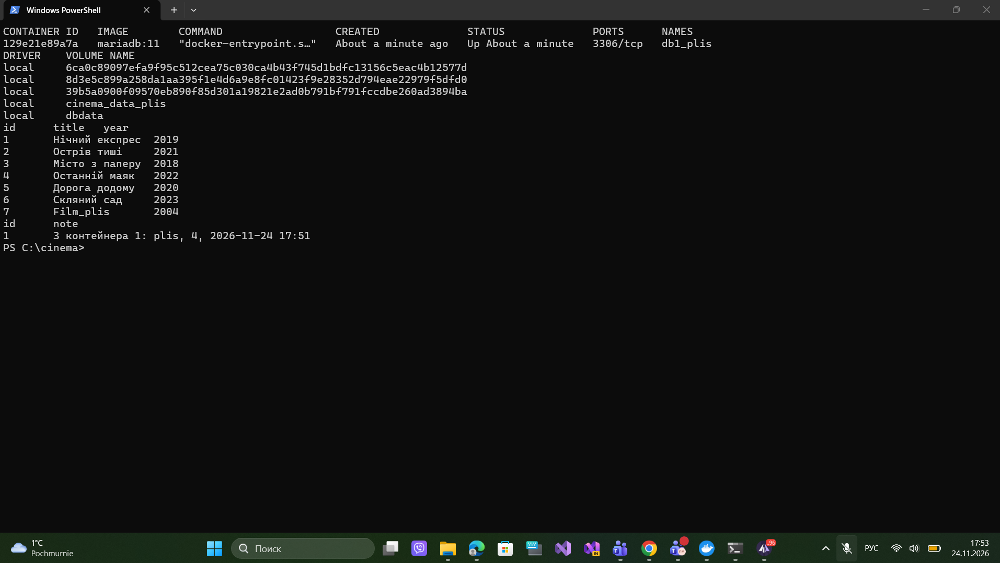 |
| 1_2: db1 видалено, том залишився | 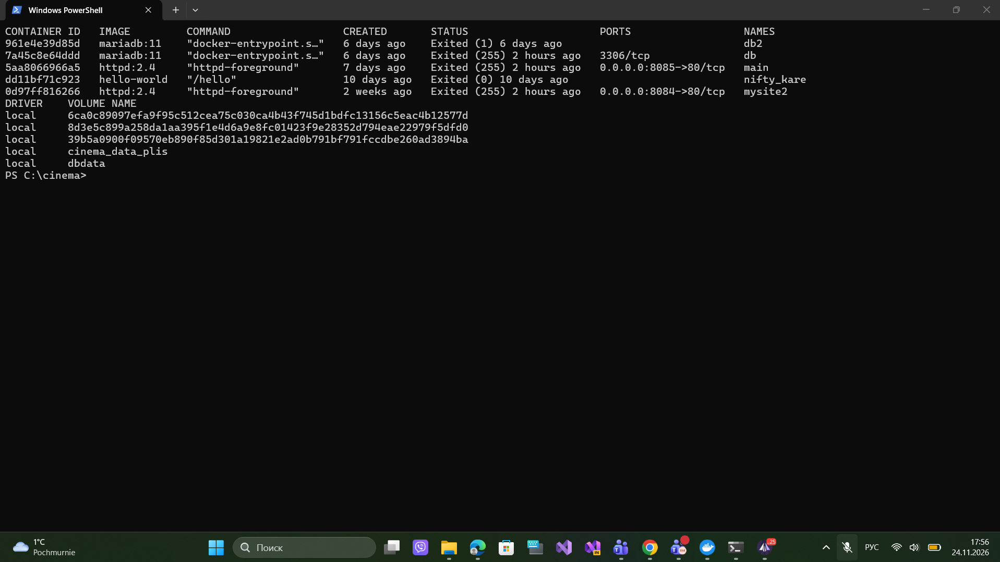 |
| 1_3: db2, 7 фільмів, 2 записи | 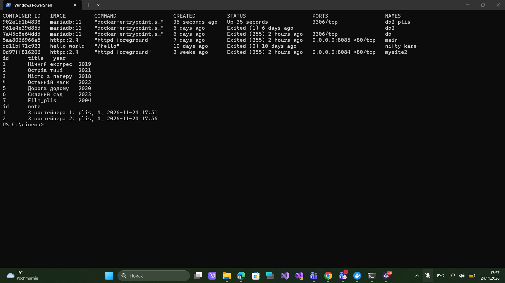 |

## Частина 2. Один сайт, два контейнери

```powershell
docker volume create site_${S}
docker run -d --name web1_$S -p "$(8100+$K):80" -v site_${S}:/usr/share/nginx/html nginx
docker run -d --name web2_$S -p "$(8200+$K):80" -v site_${S}:/usr/share/nginx/html nginx

# сторінка з папки site_src копіюється в том (через будь-який із контейнерів)
docker cp site_src\index.html web1_${S}:/usr/share/nginx/html/index.html

# після зміни на «Версія 2» - так само один docker cp, а потім папку видалено
Remove-Item -Recurse site_src
```

Результат: обидва контейнери показують ту саму сторінку, бо том у них спільний. Після видалення папки `site_src` сайт працює далі, бо сторінка лежить у томі `site_plis`.

| | |
|---|---|
| 2_1: localhost:8104, Версія 1 | 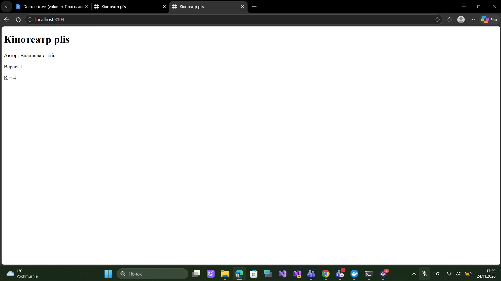 |
| 2_2: localhost:8204, Версія 1 | 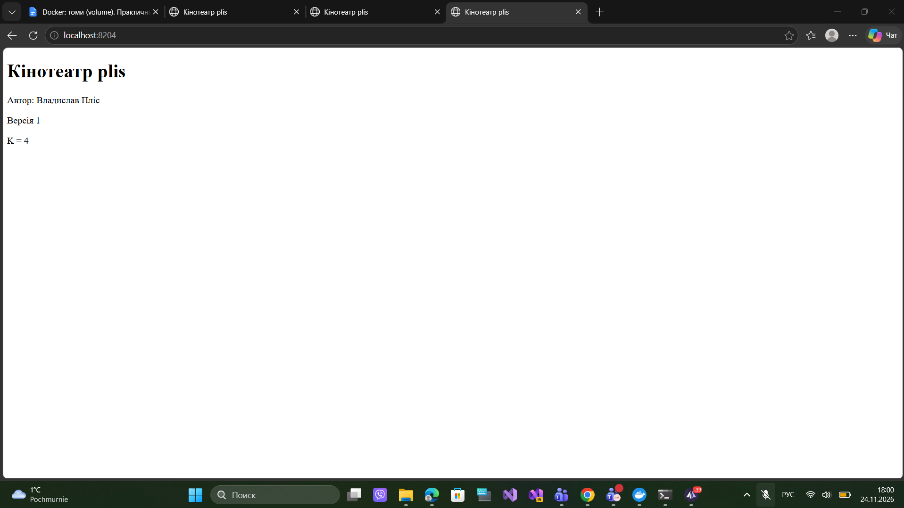 |
| 2_3: localhost:8104, Версія 2 | 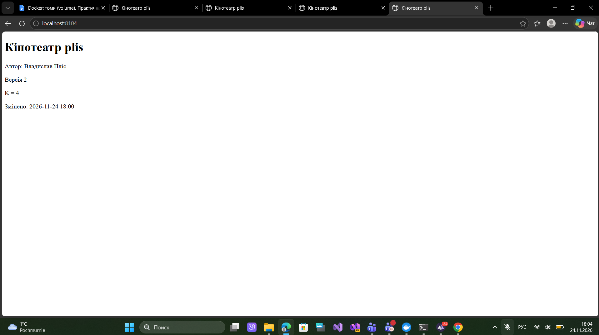 |
| 2_4: localhost:8204, Версія 2 | 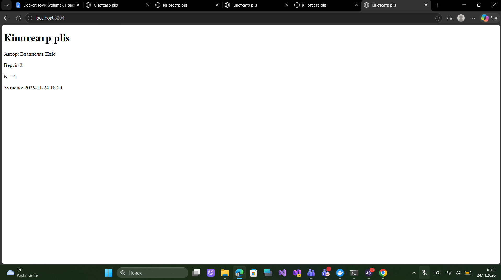 |
| 2_5: контейнери, том site_plis, папки немає | 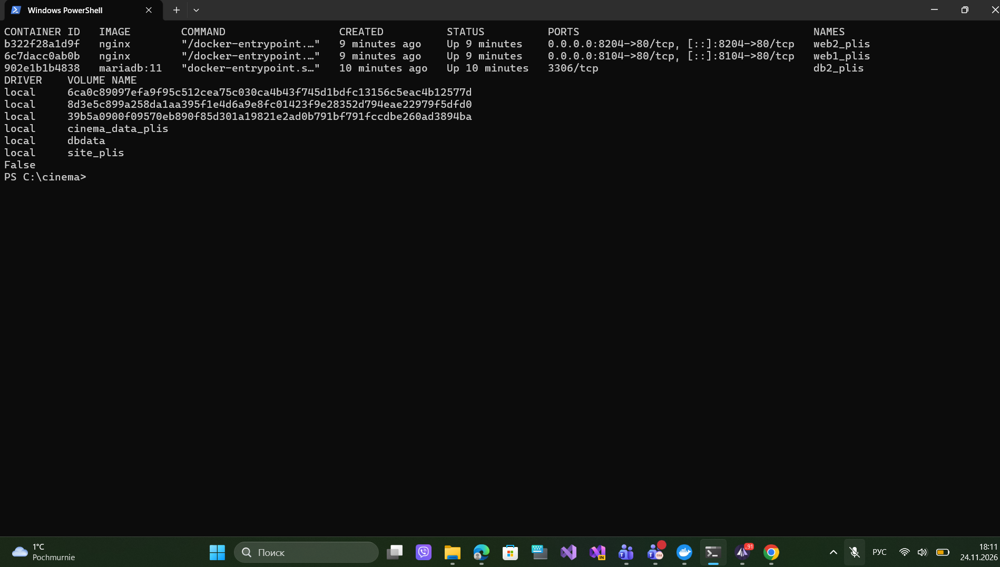 |

## Частина 3. Афіша з бази та переїзд

```powershell
Remove-Item cinema.sql
docker exec db2_plis mariadb -uroot -proot --default-character-set=utf8mb4 cinema -e "INSERT INTO films(title,year) VALUES('Archive_plis', 1904);"

# афіша: HTML-таблиці генерує сам mariadb (-H), файл кладеться в том сайту
docker exec db2_plis sh -c "{ echo '<h1>Афіша - Кінотеатр plis</h1>'; mariadb -uroot -proot -H cinema -e 'SELECT title, year FROM films'; mariadb -uroot -proot -H cinema -e 'SELECT note FROM log'; } > /tmp/afisha.html"
docker cp db2_plis:/tmp/afisha.html afisha.html
docker cp afisha.html web1_plis:/usr/share/nginx/html/afisha.html

# переїзд на нові томи
docker stop db2_plis web1_plis web2_plis
docker volume create cinema_data2_plis
docker volume create site2_plis
docker run --rm -v cinema_data_plis:/from -v cinema_data2_plis:/to alpine sh -c "cp -a /from/. /to/"
docker run --rm -v site_plis:/from -v site2_plis:/to alpine sh -c "cp -a /from/. /to/"
docker rm db2_plis web1_plis web2_plis
docker volume rm cinema_data_plis site_plis

docker run -d --name db3_plis -v cinema_data2_plis:/var/lib/mysql mariadb:11
docker run -d --name web3_plis -p 8104:80 -v site2_plis:/usr/share/nginx/html nginx
$d = Get-Date -Format "yyyy-MM-dd HH:mm"
docker exec db3_plis mariadb -uroot -proot --default-character-set=utf8mb4 cinema -e "INSERT INTO log(note) VALUES('З контейнера 3: plis, 4, $d');"
```

Результат: після переїзду афіша показує ті самі 8 фільмів і ті самі два записи, а в базі є третій запис.

| | |
|---|---|
| 3_1: афіша до переїзду | 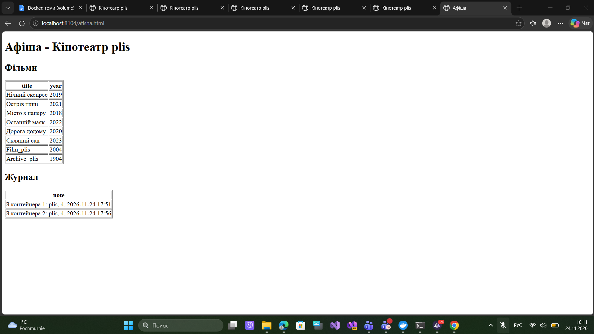 |
| 3_1: база й томи до переїзду | 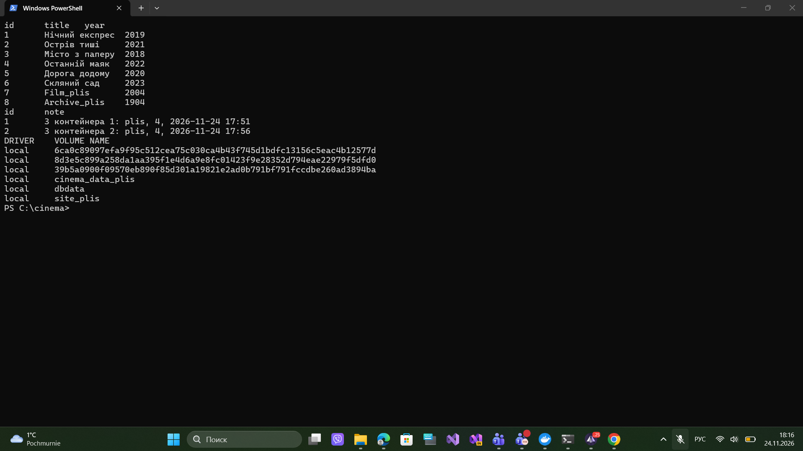 |
| 3_2: афіша після переїзду | 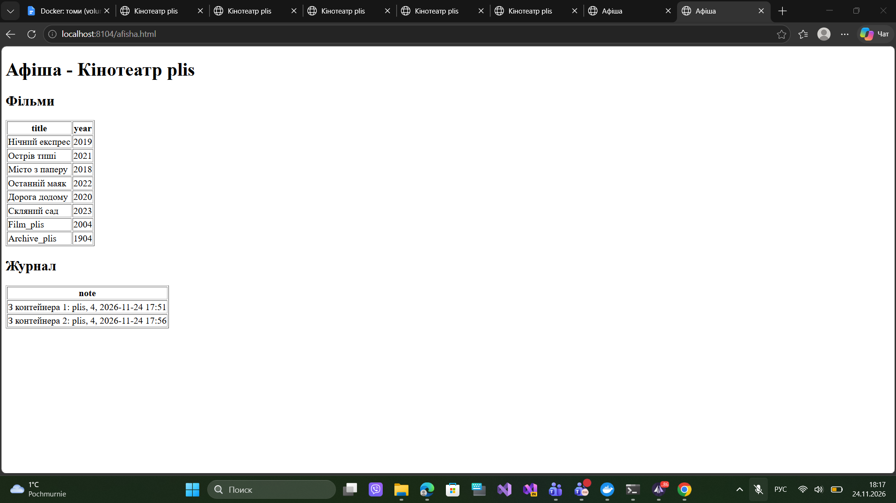 |
| 3_2: db3, web3, нові томи, 3 записи | 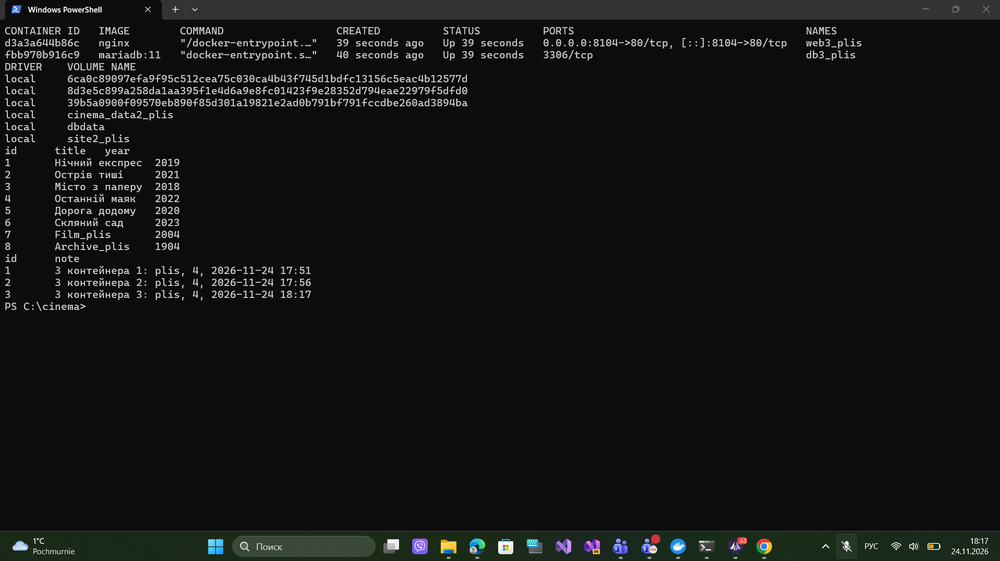 |
| 3_3: файлу cinema.sql немає | 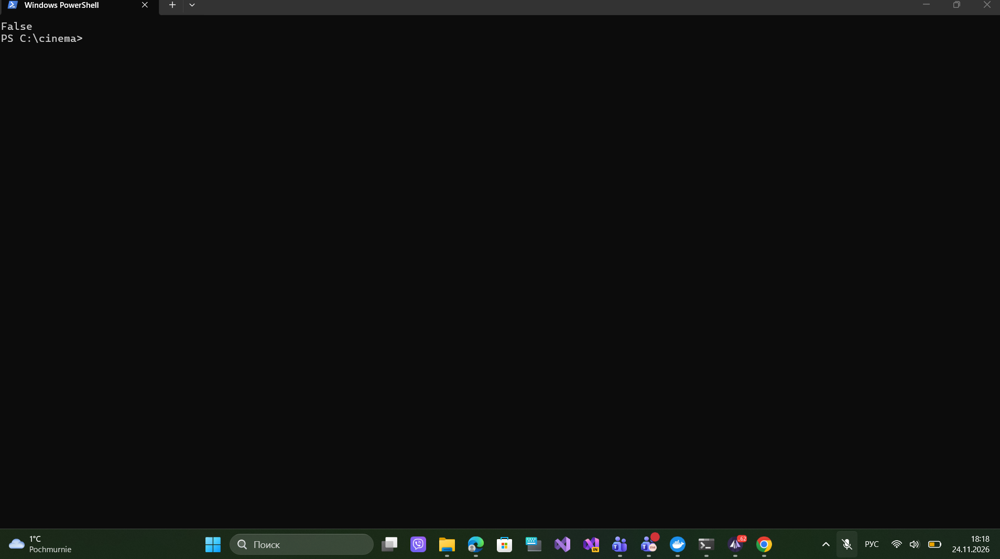 |

## Питання

**1. Чим том Docker відрізняється від папки на комп'ютері, підключеної до контейнера?**

Том Docker створює і зберігає сам Docker у своїй області, керують ним командами `docker volume`, і він не залежить від шляху на конкретному комп'ютері. Папка на комп'ютері (bind mount) - це звичайна папка хоста, яку видно у провіднику, і якщо її видалити, контейнер втратить файли. Наприклад, сайт у томі `site_plis` продовжував працювати в контейнерах `web1_plis` і `web2_plis` навіть після того, як я видалив вихідну папку `site_src`.

**2. Що відбувається з даними тома, коли видаляють контейнер, який його використовував? А коли видаляють сам том?**

Коли видаляють контейнер, дані тома зберігаються: я видалив `db1_plis`, а новий контейнер `db2_plis` підключив той самий том `cinema_data_plis` і побачив усі 7 фільмів і перший запис журналу. Коли видаляють сам том, дані зникають назавжди, тому перед командою `docker volume rm cinema_data_plis` я скопіював дані в новий том `cinema_data2_plis`, і контейнер `db3_plis` працює з ними.

## Прибирання після здачі

```powershell
docker rm -f db3_plis web3_plis
docker volume rm cinema_data2_plis site2_plis
```
